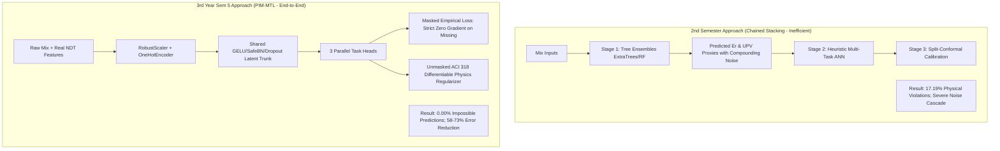

# Comprehensive Viva Voce & Technical Defense Compendium (PIM-MTL)
## Physics-Informed Masked Multi-Task Learning for Tri-Axial Concrete Mechanical Capacity

**Scope:** Master viva examination reference for `3rdYearsem5`  
**Repository Path:** `c:\Users\jeetu\projects\Capstone\3rdYearsem5`  
**Target File:** `c:\Users\jeetu\projects\Capstone\3rdYearsem5\exp.md`  
**Primary Artifacts:** `Data.csv`, `main.py`, `utils/models.py`, `utils/losses.py`, `results.txt`  

---

## Table of Contents
1. [Core Pillar 1: Physics-Informed Neural Networks (PINN)](#1-core-pillar-1-physics-informed-neural-networks-pinn)
2. [Core Pillar 2: Multi-Task Learning & Multi-Task Attention](#2-core-pillar-2-multi-task-learning--multi-task-attention)
3. [Core Pillar 3: GELU (Gaussian Error Linear Unit) Activation Function](#3-core-pillar-3-gelu-gaussian-error-linear-unit-activation-function)
4. [Core Pillar 4: Asymmetric Missing Data & Masked Gradient Gating](#4-core-pillar-4-asymmetric-missing-data--masked-gradient-gating)
5. [Core Pillar 5: Feature Engineering & Preprocessing Pipeline](#5-core-pillar-5-feature-engineering--preprocessing-pipeline)
6. [Core Pillar 6: Deep Architecture, Regularization & Numerical Stability](#6-core-pillar-6-deep-architecture-regularization--numerical-stability)
7. [Core Pillar 7: Quantitative Results, Metrics & Benchmark Audit](#7-core-pillar-7-quantitative-results-metrics--benchmark-audit)
8. [Core Pillar 8: Architectural Evolution (2nd Semester vs. 3rd Year Sem 5)](#8-core-pillar-8-architectural-evolution-2nd-semester-vs-3rd-year-sem-5)
9. [Core Pillar 9: Future Scope & Advanced Engineering (Bayesian Tuning & Attention)](#9-core-pillar-9-future-scope--advanced-engineering-bayesian-tuning--attention)
10. [Core Pillar 10: Quick-Fire Viva Trap Defense Cheat Sheet](#10-core-pillar-10-quick-fire-viva-trap-defense-cheat-sheet)

---

# 1. Core Pillar 1: Physics-Informed Neural Networks (PINN)

### Q1.1: Why did we use a PINN instead of a standard Deep Neural Network (DNN)?
- **Quick Viva Response (15-Second Pitch):**
  > *"Standard deep neural networks are unconstrained black-box statistical approximators. Under scarce or missing experimental labels, they readily output physically impossible predictions—such as tensile capacity exceeding compressive strength ($T_s \ge C_s$) or negative capacities. We implemented a Physics-Informed Neural Network (PINN) to embed civil engineering constitutive laws (ACI 318, ASTM C496, ASTM C78) directly into the loss landscape as an inductive bias."*

- **Deep Technical Explanation:**
  - Standard empirical loss minimization $\min_\theta \frac{1}{N}\sum \|y - \hat{y}\|^2$ only learns surface correlations. In regions of the feature space where tensile or flexural samples are sparse, standard networks extrapolate arbitrarily.
  - Concrete is a heterogeneous quasi-brittle material. Cracking mechanics dictate that tensile strength is only a small fraction of compressive strength.
  - The PINN framework penalizes any violation of physical reality during backpropagation, effectively narrowing the search space to physically admissible solutions.

---

### Q1.2: How is the PINN formulated mathematically in this project?
- **Quick Viva Response:**
  > *"We defined dimensionless strength ratios $R_t = \hat{T}_s / \hat{C}_s$ and $R_f = \hat{F}_s / \hat{C}_s$ based on ACI 318 standards and penalized out-of-bound ratios using a differentiable two-sided quadratic hinge loss $\mathcal{L}_{\text{phys}}$ on all specimens."*

- **Full Mathematical Derivation:**
  1. **Differentiable Denormalization:** Predictions in normalized space ($\hat{\mathbf{y}}_{\text{scaled}}$) are converted into real physical units ($\text{MPa}$) inside PyTorch:
     $$\hat{\mathbf{y}}_{\text{MPa}} = \hat{\mathbf{y}}_{\text{scaled}} \odot \mathbf{s} + \boldsymbol{\mu}$$
     where $\mathbf{s} \in \mathbb{R}^3$ are target scale factors and $\boldsymbol{\mu} \in \mathbb{R}^3$ are target center shifts from `RobustScaler`.
  2. **Numerical Clamping:**
     $$\hat{C}_s = \max(\hat{y}_{1, \text{MPa}},\, 1.0), \quad \hat{T}_s = \max(\hat{y}_{2, \text{MPa}},\, 0.0), \quad \hat{F}_s = \max(\hat{y}_{3, \text{MPa}},\, 0.0)$$
     *Why clamp $\hat{C}_s \ge 1.0\text{ MPa}$?* To avoid division-by-zero singularities when calculating ratios during early training epochs.
  3. **Dimensionless Physical Ratios:**
     $$R_t = \frac{\hat{T}_s}{\hat{C}_s}, \qquad R_f = \frac{\hat{F}_s}{\hat{C}_s}$$
  4. **Engineering Ratio Bounds (ACI 318-19 / Eurocode 2):**
     - Splitting Tensile Ratio: $R_t \in [r_t^{\min}, r_t^{\max}] = [0.06,\, 0.18]$
     - Flexural Rupture Ratio: $R_f \in [r_f^{\min}, r_f^{\max}] = [0.08,\, 0.25]$
  5. **Differentiable Quadratic Hinge Penalty ($\mathcal{L}_{\text{phys}}$):**
     $$\mathcal{L}_{\text{phys}} = \frac{1}{N} \sum_{i=1}^N \Big[ \underbrace{\text{ReLU}(R_{t,i} - 0.18)^2}_{\text{Upper Tensile Penalty}} + \underbrace{\text{ReLU}(0.06 - R_{t,i})^2}_{\text{Lower Tensile Penalty}} + \underbrace{\text{ReLU}(R_{f,i} - 0.25)^2}_{\text{Upper Flexural Penalty}} + \underbrace{\text{ReLU}(0.08 - R_{f,i})^2}_{\text{Lower Flexural Penalty}} \Big]$$
  6. **Composite Objective Function:**
     $$\mathcal{L}_{\text{total}} = \mathcal{L}_{\text{data}} + \lambda_{\text{phys}} \mathcal{L}_{\text{phys}}, \quad \text{where } \lambda_{\text{phys}} = 0.5$$

- **Code Location:** `utils/losses.py`, lines 68–90 in `PIM_loss()`.

---

### Q1.3: Follow-Up Trap: "Is the physics loss computed only on samples with valid ground-truth labels?"
- **The Exact Answer:**
  > *"No! That is the fundamental strength of our design. $\mathcal{L}_{\text{data}}$ is masked to observed samples, but $\mathcal{L}_{\text{phys}}$ is computed over **ALL $N$ specimens** in the batch (100% of samples). Even if a specimen lacks experimental tensile and flexural measurements, its predicted outputs are constrained by the physics loss relative to its predicted compressive strength."*

---

### Q1.4: Why quadratic hinge loss ($\text{ReLU}(x)^2$) instead of linear hinge ($\text{ReLU}(x)$)?
- **Deep Technical Explanation:**
  - The derivative of standard linear hinge loss $\text{ReLU}(u)$ is discontinuous (a step function, undefined at $u=0$). This causes high-frequency gradient jitter near the boundary.
  - Quadratic hinge $\text{ReLU}(u)^2$ has a continuous first derivative:
    $$\frac{d}{du}\left[\text{ReLU}(u)^2\right] = 2 \cdot \text{ReLU}(u)$$
  - This guarantees smooth gradient backpropagation at the boundary $R_t = 0.06$ and $R_t = 0.18$, penalizing minor deviations gently and severe deviations quadratically.

---

# 2. Core Pillar 2: Multi-Task Learning & Multi-Task Attention

### Q2.1: What is Multi-Task Learning (MTL), and why did we choose it over three separate regression models?
- **Quick Viva Response:**
  > *"In concrete mechanics, compressive ($C_s$), tensile ($T_s$), and flexural ($F_s$) strengths are not independent phenomena. They all originate from the identical chemical hydration matrix, water-to-cement ratio, porosity, and aggregate interlocking. MTL allows our network to learn a shared representation, enabling positive cross-task transfer while saving memory and compute."*

- **Deep Technical Comparison:**
  1. **Single-Task Networks:** Training 3 separate networks requires 3 independent optimizers, triples parameter storage, and prevents the $F_s$ model (which has 60.2% missing labels) from benefiting from the 4,420 complete $C_s$ labels.
  2. **Multi-Task Network:** A single 3-layer shared encoder ($19 \rightarrow 128 \rightarrow 64 \rightarrow 32$) maps raw mix design into a 32-dimensional latent feature vector $\mathbf{h}_3$. Three dedicated linear heads then map $\mathbf{h}_3$ to $[C_s, T_s, F_s]$.
  3. **Data Efficiency:** The heavily observed compressive data acts as an anchor that trains the shared encoder trunk, providing rich representations to the data-starved tensile and flexural heads.

---

### Q2.2: What is Multi-Task Attention, and how does it work?
- **Quick Viva Response:**
  > *"Multi-Task Attention is a dynamic routing mechanism where task-specific queries attend across shared intermediate features or cross-task latent spaces. It allows each task head to adaptively select the features most relevant to its mechanical failure mode, preventing destructive gradient interference."*

- **Mathematical Formulation:**
  Using the Transformer Scaled Dot-Product Attention formulation:
  $$\text{Attention}(\mathbf{Q}_k, \mathbf{K}, \mathbf{V}) = \text{softmax}\left( \frac{\mathbf{Q}_k \mathbf{K}^T}{\sqrt{d_k}} \right) \mathbf{V}$$
  - **Task Query ($\mathbf{Q}_k$):** A learned parameter vector specific to task $k \in \{\text{Compressive}, \text{Tensile}, \text{Flexural}\}$.
  - **Key ($\mathbf{K}$) & Value ($\mathbf{V}$):** Projections of the shared latent representations derived from mix composition, curing time, and non-destructive test (NDT) features.
  - **Physical Interpretation:**
    - For **Compressive Strength ($C_s$)**, the attention mechanism weights bulk matrix density and ultrasonic pulse velocity (`UPV`) heavily.
    - For **Flexural Strength ($F_s$)**, the attention mechanism prioritizes aggregate geometry (`Type_of_aggregates`), interfacial transition zone (ITZ) characteristics, and fiber/biopolymer additives (`Additives`).

---

### Q2.3: How does Multi-Task Attention prevent "Negative Transfer" (Gradient Conflict)?
- **Deep Technical Explanation:**
  - **The Phenomenon of Negative Transfer:** When training multiple tasks jointly, their gradients with respect to shared weights $\mathbf{W}_{\text{shared}}$ can point in opposite directions:
    $$\langle \nabla_{\mathbf{W}} \mathcal{L}_i,\, \nabla_{\mathbf{W}} \mathcal{L}_j \rangle < 0$$
    When this occurs, an update that improves Task $i$ actively degrades Task $j$.
  - **Attention as a Decoupler:** Multi-Task Attention mitigates negative transfer by dynamically modulating the flow of information. Rather than forcing all three tasks to share the identical static vector $\mathbf{h}_3$, each task constructs its own tailored context vector $\mathbf{c}_k = \sum_j \alpha_{k, j} \mathbf{v}_j$, preserving task autonomy while maintaining shared knowledge transfer.

---

### Q2.4: What is the current model architecture in `models.py` versus the Attention Roadmap?
- **Code Anchor & Viva Honesty:**
  > *"In our baseline implementation (`PIM_MTL_Net` in [`utils/models.py`](file:///c:/Users/jeetu/projects/Capstone/3rdYearsem5/utils/models.py#L35-L59)), we utilize **Hard Parameter Sharing** consisting of a shared 3-layer trunk with SafeBatchNorm1d, GELU, and Dropout, terminating in 3 parallel linear heads.  
  > In our future roadmap (documented in `sem5.md`), we propose replacing static linear trunk compression with **Multi-Task Cross-Attention**, allowing dynamic feature gating between $C_s, T_s,$ and $F_s$."*

---

# 3. Core Pillar 3: GELU (Gaussian Error Linear Unit) Activation Function

### Q3.1: What is GELU, and what is its mathematical definition?
- **Quick Viva Response:**
  > *"GELU is a smooth, continuous activation function that weights an input by the probability that a standard Gaussian variable is less than that input. Unlike ReLU which truncates negatives to zero, GELU allows small, smooth negative values, preserving gradient flow."*

- **Mathematical Definition:**
  $$\text{GELU}(x) = x \cdot \Phi(x) = x \cdot P(X \le x), \quad \text{where } X \sim \mathcal{N}(0, 1)$$
  $$\text{GELU}(x) = x \cdot \frac{1}{2} \left[ 1 + \text{erf}\left(\frac{x}{\sqrt{2}}\right) \right]$$
  where $\text{erf}(z) = \frac{2}{\sqrt{\pi}} \int_0^z e^{-t^2} dt$ is the error function.
  
  **Fast Numerical Approximation:**
  $$\text{GELU}(x) \approx 0.5x \left( 1 + \tanh\left(\sqrt{\frac{2}{\pi}} \left(x + 0.044715 x^3\right)\right) \right)$$

---

### Q3.2: Why did we use GELU instead of standard ReLU or LeakyReLU?
- **Key Technical Distinctions for Viva:**

| Feature | ReLU | LeakyReLU | GELU (Our Choice) |
|---|---|---|---|
| **Mathematical Equation** | $\max(0, x)$ | $\max(\alpha x, x)$ | $x \cdot \Phi(x)$ |
| **Differentiability** | $C^0$ (non-differentiable at $x=0$) | $C^0$ (kink at $x=0$) | $C^\infty$ (infinitely smooth everywhere) |
| **Dying Neuron Problem** | High risk ($\nabla_x = 0$ for $x \le 0$) | Mitigated by fixed slope $\alpha$ | **Eliminated** by smooth probabilistic curve |
| **Non-Monotonicity** | Strictly monotonic | Strictly monotonic | **Non-monotonic** (smooth minimum at $\approx -0.75$) |
| **PINN Compatibility** | Gradient jumps disrupt PDE/ratio loss | Constant slope ignores probabilistic density | **Superior**: smooth 1st & 2nd derivatives |

- **Physical Rationale for Concrete Modeling:**
  1. **Smooth Optimization Landscape:** The physics loss $\mathcal{L}_{\text{phys}}$ calculates ratios of network outputs ($T_s / C_s$). If the hidden representations contain piece-wise sharp kinks from ReLU, backpropagating through ratio denominators introduces gradient instability. GELU's smooth curvature stabilizes training.
  2. **Non-Dying Activations:** In materials science data, continuous variables like electrical resistivity (`Er_ohm-cm`) span non-linear ranges. Standard ReLU often deactivates up to 30% of neurons during early training epochs. GELU retains negative gradient signal, allowing dormant neurons to recover.

---

# 4. Core Pillar 4: Asymmetric Missing Data & Masked Gradient Gating

### Q4.1: What is the exact missing data distribution in ConcreteXAI?
- **Must-Know Numbers for Viva:**
  - Total Mixes: **4,420 experimental concrete batches**
  - **Compressive Strength ($C_s$):** **4,420 observed (100.0% complete)**
  - **Splitting Tensile Strength ($T_s$):** **3,460 observed | 960 missing (21.7% missing)**
  - **Flexural Strength ($F_s$):** **1,760 observed | 2,660 missing (60.2% missing)**
  - **Complete Triplet (All 3 Present):** **1,760 mixes (Only 39.8% of the dataset)**

---

### Q4.2: Why did we reject Traditional Missing Data Techniques?
- **Examiner's Favorite Question:** *"Why not just drop rows with missing values or use KNN/MICE imputation?"*
- **The Definite Answer:**
  1. **Complete Case Dropping (Listwise Deletion):**
     - Discards **2,660 specimens (60.2% of the dataset)**.
     - Destroys statistical power and sample diversity.
     - Introduces severe **laboratory selection bias**: flexural testing is usually performed only on premium high-strength mixes, so dropping incomplete cases discards standard everyday concrete mixes.
  2. **Statistical Imputation (Mean, Median, KNN, MICE):**
     - Fills missing cells with *hallucinated, synthetic target values*.
     - When the network minimizes $(y_{\text{imputed}} - \hat{y})^2$, it calculates gradients against fabricated data, corrupting genuine physical correlations between hydration inputs and strength outputs.

---

### Q4.3: How does our project handle missing data? (Step-by-Step Mechanism)
- **Detailed Explanation:**
  Missing data is handled via **Masked Gradient Gating**:
  
  1. **Phase 1: Before Training (`load_and_preprocess()` in `main.py`):**
     - A binary observation mask tensor $\mathbf{M} \in \{0.0, 1.0\}^{N \times 3}$ is constructed:
       $$m_{ij} = \begin{cases} 1.0 & \text{if } y_{ij} \text{ is observed (valid laboratory test)} \\ 0.0 & \text{if } y_{ij} \text{ is missing (NaN)} \end{cases}$$
     - Target arrays are scaled with `RobustScaler`. Missing cells are assigned a computational placeholder of $0.0$ strictly to satisfy PyTorch dense tensor shape requirements. **This $0.0$ is NOT an imputed label.**
  
  2. **Phase 2: During Training (`PIM_loss()` in `utils/losses.py`):**
     - The squared error matrix is multiplied element-wise by the mask tensor $\mathbf{M}$.
     - Each task's loss is normalized strictly by its observed sample count:
       $$\mathcal{L}_{\text{data}} = \sum_{j=1}^3 w_j \left[ \frac{\sum_{i=1}^N m_{ij} \cdot (\hat{y}_{ij} - y_{ij})^2}{\max\left(1, \sum_{k=1}^N m_{kj}\right)} \right]$$

---

### Q4.4: Mathematical Proof of Zero Gradient for Missing Values
- **The Formal Proof:**
  Let the loss for task $j$ on batch of size $N$ be:
  $$\mathcal{L}_j = \frac{1}{N_{\text{obs}, j}} \sum_{i=1}^N m_{ij} \cdot (\hat{y}_{ij} - y_{ij})^2, \quad \text{where } N_{\text{obs}, j} = \sum_{k=1}^N m_{kj}$$
  
  Take the partial derivative of $\mathcal{L}_j$ with respect to the network's prediction $\hat{y}_{ij}$:
  $$\frac{\partial \mathcal{L}_j}{\partial \hat{y}_{ij}} = \frac{2 \cdot m_{ij} \cdot (\hat{y}_{ij} - y_{ij})}{N_{\text{obs}, j}}$$

  - **When observed ($m_{ij} = 1.0$):**
    $$\frac{\partial \mathcal{L}_j}{\partial \hat{y}_{ij}} = \frac{2(\hat{y}_{ij} - y_{ij})}{N_{\text{obs}, j}} \neq 0 \implies \text{Normal empirical gradient backpropagates.}$$
  - **When missing ($m_{ij} = 0.0$):**
    $$\frac{\partial \mathcal{L}_j}{\partial \hat{y}_{ij}} = \frac{2 \cdot \mathbf{0} \cdot (\hat{y}_{ij} - 0.0)}{N_{\text{obs}, j}} \equiv \mathbf{0.0}$$
  
  $$\therefore \text{Gradient is mathematically ZERO. The placeholder } 0.0 \text{ has zero influence on the model!}$$

---

### Q4.5: If the empirical gradient is zero for missing labels, how does the head learn?
- **Viva Defense Point:**
  > *"The unobserved head learns through **Dual Inductive Supervision**:  
  > 1. **Shared Trunk Backbone:** The shared encoder is continuously trained on the 100% complete compressive strength data ($C_s$). The learned chemical and physical representation $\mathbf{h}_3$ directly benefits all three heads.  
  > 2. **Unmasked Continuum Physics Loss:** The physics loss $\mathcal{L}_{\text{phys}}$ is evaluated on **every single specimen**. If the flexural head predicts an unphysical value (e.g., $F_s > 0.25 C_s$ or $F_s < 0.08 C_s$), $\mathcal{L}_{\text{phys}}$ fires a non-zero restorative gradient, steering the unobserved head into compliance."*

---

# 5. Core Pillar 5: Feature Engineering & Preprocessing Pipeline

### Q5.1: What are the input features, and how is the 19-dimensional input vector formed?
- **Breakdown of the 19 Dimensions:**
  - **4 Categorical Features $\rightarrow$ 15 One-Hot Encoded Dimensions:**
    1. `Type_of_cement` (4 levels: CPC 30R, CPO 30R RS BRA, CPC 30R RS, CPC 40R)
    2. `Brand` (2 levels: CEMEX, Apasco)
    3. `Additives` (5 levels: None, Opuntia biopolymer, Slag, Fluidizers)
    4. `Type_of_aggregates` (4 levels: Crushed, Rounded gravel, Recycled, Volcanic)
    *(OneHotEncoder with `handle_unknown="ignore"`).*
  - **4 Continuous Numerical Features $\rightarrow$ 4 Robust Scaled Dimensions:**
    1. `Design_Fc_Mpa`: Target design strength ($20 - 35\text{ MPa}$)
    2. `Curing_age_days`: Hydration period ($7 - 120\text{ days}$)
    3. `Er_ohm-cm`: Electrical resistivity non-destructive proxy ($1.43 - 23.95\ \Omega\cdot\text{cm}$)
    4. `UPV_m/s`: Ultrasonic Pulse Velocity non-destructive proxy ($2,431 - 5,319\text{ m/s}$)
  - **Total Input Vector Size:** $15 + 4 = 19\text{ features}$.

---

### Q5.2: Why did we use `RobustScaler` instead of `StandardScaler` or `MinMaxScaler`?
- **Quick Viva Response:**
  > *"Concrete electrical resistivity (`Er_ohm-cm`) and curing ages exhibit severe right-tail skewness due to exponential pore water percolation. `StandardScaler` uses the mean and variance, which are distorted by outliers. `MinMaxScaler` squashes non-outlier data into tiny intervals. `RobustScaler` scales based on the Median and Interquartile Range (IQR), making it resistant to measurement outliers."*

- **Mathematical Formula:**
  $$x_{\text{scaled}} = \frac{x - \text{median}(X)}{\text{IQR}(X)}, \quad \text{where } \text{IQR} = Q_3 - Q_1$$

---

### Q5.3: How was data leakage prevented during preprocessing?
- **The Answer:**
  > *"The dataset was split into 80% train (3,536 samples) and 20% test (884 samples) using a fixed seed (`seed=42`). `OneHotEncoder`, `RobustScaler(X)`, and target scalers `RobustScaler(Y)` were **strictly fitted on the training split only** (`fit_transform`). The test set was transformed using the fitted training parameters (`transform`)."*

---

# 6. Core Pillar 6: Deep Architecture, Regularization & Numerical Stability

### Q6.1: What is the layer-by-layer architecture and parameter count?
- **Architectural Diagram:**
```text
Input Features x in R^19
        │
        ▼
Linear(19 -> 128) -> SafeBatchNorm1d(128) -> GELU -> Dropout(p=0.2)
        │
        ▼
Linear(128 -> 64) -> SafeBatchNorm1d(64)  -> GELU
        │
        ▼
Linear(64 -> 32)   [ Shared Representation h_3 in R^32 ]
        │
  ┌─────┴─────────────────────┬─────────────────────┐
  │                           │                     │
  ▼                           ▼                     ▼
Linear(32 -> 1)             Linear(32 -> 1)       Linear(32 -> 1)
Cs Head (Compressive)       Ts Head (Tensile)     Fs Head (Flexural)
```

- **Exact Parameter Count Audit:**
  - **Layer 1:** $(19 \times 128) + 128\text{ bias} + (2 \times 128\text{ BN params}) = 2,432 + 128 + 256 = \mathbf{2,816}$
  - **Layer 2:** $(128 \times 64) + 64\text{ bias} + (2 \times 64\text{ BN params}) = 8,192 + 64 + 128 = \mathbf{8,384}$
  - **Layer 3:** $(64 \times 32) + 32\text{ bias} = 2,048 + 32 = \mathbf{2,080}$
  - **Task Heads:** $3 \times (32 \times 1 + 1\text{ bias}) = 3 \times 33 = \mathbf{99}$
  - **Total Trainable Parameters:** **13,379 parameters**.

---

### Q6.2: What is `SafeBatchNorm1d` and why did we write a custom class for it?
- **Quick Viva Response:**
  > *"PyTorch's default `nn.BatchNorm1d` throws a runtime exception if a batch has a batch size of $N=1$ during training because sample variance cannot be computed ($N - 1 = 0$). We wrote `SafeBatchNorm1d` to dynamically detect single-sample batches and fall back to accumulated running statistics, ensuring uninterrupted edge and on-site inference."*

- **Code Location:** `utils/models.py`, lines 15–33.

---

### Q6.3: What weight initialization was used and why?
- **The Answer:**
  > *"We used **Kaiming Normal (He) Initialization** (`nn.init.kaiming_normal_`), drawing weights from $\mathcal{N}\left(0, \sqrt{2 / \text{fan\_in}}\right)$. Because our network has deep linear layers with non-linear activations, Kaiming initialization prevents vanishing or exploding gradients during early epochs."*

---

### Q6.4: What optimization schedule and gradient clipping were used?
- **The Answer:**
  - **Optimizer:** `Adam` ($\text{lr} = 10^{-3}$, weight decay $= 10^{-4}$).
  - **Learning Rate Scheduler:** `CosineAnnealingLR` decaying $\eta_{\max} = 10^{-3} \rightarrow \eta_{\min} = 10^{-5}$ across 60 epochs.
  - **Gradient Clipping:** `torch.nn.utils.clip_grad_norm_(model.parameters(), max_norm=5.0)` to safeguard against gradient explosions caused by physics penalty ratios.

---

# 7. Core Pillar 7: Quantitative Results, Metrics & Benchmark Audit

### Q7.1: What are our final test results on unseen concrete specimens?
- **Verified Results from `results.txt` (884 Unseen Test Specimens):**

| Target Metric | Test Samples ($N$) | Coverage | $R^2$ Score | RMSE (MPa) | MAE (MPa) |
|---|---|---|---|---|---|
| **Compressive Strength ($C_s$)** | 884 | 100.0% | **0.9812** | 1.3353 | 1.0183 |
| **Splitting Tensile Strength ($T_s$)** | 696 | 78.7% | **0.9867** | 0.1060 | 0.0761 |
| **Flexural Strength ($F_s$)** | 363 | 41.1% | **0.9982** | 0.1024 | 0.0755 |

---

### Q7.2: What is the Physical Feasibility Audit of our model?
- **Compliance Metrics:**
  - **Physically Impossible Predictions ($T_s \ge C_s$):** **0.00% (100.0% Compliant)**
  - **Tensile Ratio Compliance ($R_t \in [0.06, 0.18]$):** **96.83% Compliant** (Only 3.17% violation)
  - **Flexural Ratio Compliance ($R_f \in [0.08, 0.25]$):** **82.24% Compliant** (17.76% minor violation)

---

# 8. Core Pillar 8: Architectural Evolution (2nd Semester vs. 3rd Year Sem 5)

### Q8.1: How does our 3rd Year Sem 5 approach differ from the 2nd Semester pipeline?
- **Examiner's Intent:** Demonstrating project maturity and progressive engineering evolution.

- **Direct Architectural Comparison:**



- **Three Critical Reasons the 2nd Semester Pipeline Was Discarded:**
  1. **Compounding Noise Cascade:** Stage 1 predicted $Er$ and $UPV$ proxies; feeding noisy proxy predictions into Stage 2 amplified errors non-linearly.
  2. **Incomplete Sample Deletion:** The 2nd semester model dropped samples lacking complete labels, discarding 60.2% of the dataset.
  3. **Heuristic Penalties vs. Differentiable Physics:** 2nd semester used ad-hoc penalty coefficients; Sem 5 implements continuous dimensionless ratios normalized directly in MPa space.

---

# 9. Core Pillar 9: Future Scope & Advanced Engineering (Bayesian Tuning & Attention)

### Q9.1: How will automated Bayesian Hyperparameter Optimization be integrated?
- **The Pitch:**
  > *"Currently, hyperparameters ($\lambda_{\text{phys}}=0.5$, hidden dimensions $[128, 64, 32]$, task weights $[1.0, 1.2, 1.5]$) were selected empirically. In our future scope, we formulate a multi-objective acquisition function optimized via **Tree-structured Parzen Estimators (Optuna)** or **Gaussian Process Expected Improvement (BoTorch)**."*

- **The Multi-Objective Optimization Formulation:**
  $$\max_{\boldsymbol{\theta} \in \Theta} \mathcal{J}(\boldsymbol{\theta}) = \overline{R^2}(\boldsymbol{\theta}) - \gamma_1 \cdot \text{PVR}_t(\boldsymbol{\theta}) - \gamma_2 \cdot \text{PVR}_f(\boldsymbol{\theta})$$
  where $\text{PVR}$ is the Physical Violation Rate, and $\gamma_1, \gamma_2$ are penalty weights ensuring models balance statistical accuracy and code compliance.

---

# 10. Core Pillar 10: Quick-Fire Viva Trap Defense Cheat Sheet

| Question Asked by Examiner | The Fatal Mistake (What NOT to say) | The Perfect Winning Answer (What to Say) |
|---|---|---|
| **"Did you fill missing values with 0?"** | *"Yes, we filled missing cells with 0 before training."* | **"No! $0.0$ is solely an internal matrix placeholder. Our loss function multiplies by a binary mask $M=0$, guaranteeing that backpropagated gradients for missing values are strictly zero."** |
| **"Why not train 3 separate models?"** | *"We wanted to save training time."* | **"Separate models ignore the shared physical cement hydration process and prevent the data-starved flexural head (60.2% missing) from learning from complete compressive tests."** |
| **"Why did you use GELU instead of ReLU?"** | *"GELU is newer and popular in Transformers."* | **"GELU provides $C^\infty$ smooth curvature without non-differentiable kinks at 0. This prevents dying neurons and stabilizes backpropagation through our physics ratio loss."** |
| **"How can you claim PINN when you don't solve Navier-Stokes or Burgers PDEs?"** | *"Our equations are PDEs."* | **"PINNs are not restricted to differential equations. In structural materials engineering, constitutive empirical equations and ACI 318 ratio bounds serve as the governing continuum mechanics constraints."** |
| **"What is Multi-Task Attention?"** | Confusing it with self-attention in text. | **"It is a task-queried attention mechanism that routes relevant microstructural and NDT features to specific mechanical strength heads, mitigating inter-task gradient conflict."** |
| **"What if UPV or Er are unavailable on-site?"** | *"The model will crash."* | **"In our 2nd semester research, we proved that tree ensembles can virtually sense $Er$ and $UPV$ from nominal mix components, allowing deployment even under missing NDT sensors."** |
